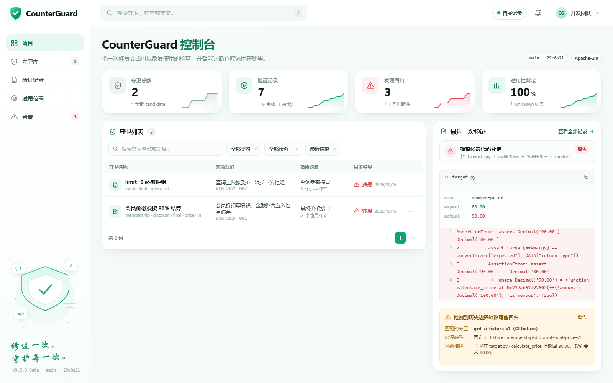

# CounterGuard

Fixed bugs should stay fixed.

AI assistants edit code without knowing what you fixed before, so the same bug keeps coming back. CounterGuard compiles each confirmed fix into a small check you can replay, and learns which code that check belongs to.

> [中文](README.md)　|　[v0.5.0 Beta](https://github.com/kokoJesee/CounterGuard/releases/tag/v0.5.0)　|　Not on PyPI

## Try it

```powershell
uv sync
uv run counterguard demo --scenario examples/demo/mvp.yaml --workspace artifacts/quickstart-v1
```

One command runs capture, compile, scope learning and replay, then writes `report.json` and `report.md`. It works offline and makes no model calls.

To install the wheel and actually run tests:

```powershell
uv build
python -m pip install "dist/counterguard-0.5.0-py3-none-any.whl[runner]"
```

The `runner` extra brings in pytest. Without it the command exits `3` before writing anything. The demo also needs `examples/`, `benchmarks/` and `experiments/` from the source tree, which are not part of the wheel.

The scenario file is called `mvp.yaml`, but the parser only accepts a JSON subset. Valid input is in the [quickstart](docs/quickstart.md).

## Why not just regression tests

A normal test remembers an assertion, but not where that assertion belongs. Applied too broadly it flags correct code; applied too narrowly it lets the old bug back in.

CounterGuard learns the boundary from confirmed legal counterexamples instead of hand-written rules. The learned condition only looks at code features, never paths, names or expected values.

## Three answers, kept apart

| Field | Values |
|---|---|
| `scope_decision` | `applicable` / `inapplicable` / `unknown` |
| `execution_outcome` | `not_run` / `pass` / `fail` / `error` / `timeout` |
| `final_verdict` | `pass` / `violation` / `skipped` / `inconclusive` |

Inapplicable and unknown targets never start pytest; they are recorded as `not_run` plus `skipped`. A skipped row is never a pass. Field definitions are in the [CLI contract](docs/cli.md).

## What one fix becomes

1. **Capture.** The same cases run against the old and new revision. Only a real failure followed by a real pass counts as reproducible evidence.
2. **Compile.** The failing cases become a minimal Guard, which must pass on the fixed target before it is published.
3. **Learn the boundary.** Applicability is learned from confirmed counterexamples. Holdout samples never enter fitting.
4. **Replay.** Applicability is decided first; only then does pytest run. Skipped rows keep `run = null`.

## What is in the box

15 labeled targets (9 train / 6 holdout) and two guards: membership discount and query limit.

On the six held-out targets, adding counterexamples cut false applications from 2 to 0 while keeping both applicable targets. Those six labels are public, so this is engineering validation, not a blind benchmark. Full numbers are in the [evaluation notes](docs/evaluation.md).

## Console

The repository also ships a static console. Double-click is enough:

```powershell
python console/tools/export_console_data.py --root .
start console/index.html
```

Exported data contains local paths and is excluded by `console/.gitignore`, so a fresh clone needs one export first. The console shows guards, every replay, applicability decisions and alerts. More in the [console docs](console/README.md).



## Boundaries

It works with Python 3.12+, pytest 8.4, root or `src/` layouts and projects with no runtime dependencies; repository code runs in a reviewed Docker image.

It is not a sandbox for arbitrary Python projects, and it does not yet generalize to later source changes. The verification records here are not a guarantee of cross-platform behavior, malicious-repository isolation or signature-based authentication.

## More docs

- [Repository verification](docs/verify.md) and [guard lifecycle](docs/guard-lifecycle.md)
- [Admission conditions](docs/project-admission.md), [roadmap](docs/roadmap.md) and the [boltons trial](docs/results/onboarding-boltons-v1/README.md)
- [Security model](docs/security-model.md), [attack surface checklist](docs/attack-surface-checklist.md) and [known limitations](docs/known-limitations.md)

## Development

```powershell
uv run pytest -m "not slow" -q      # fast tier
uv run ruff check .
```

Tests that start real processes must be marked `slow`. The rules are in [testing.md](docs/testing.md).

## License

[Apache-2.0](LICENSE)
