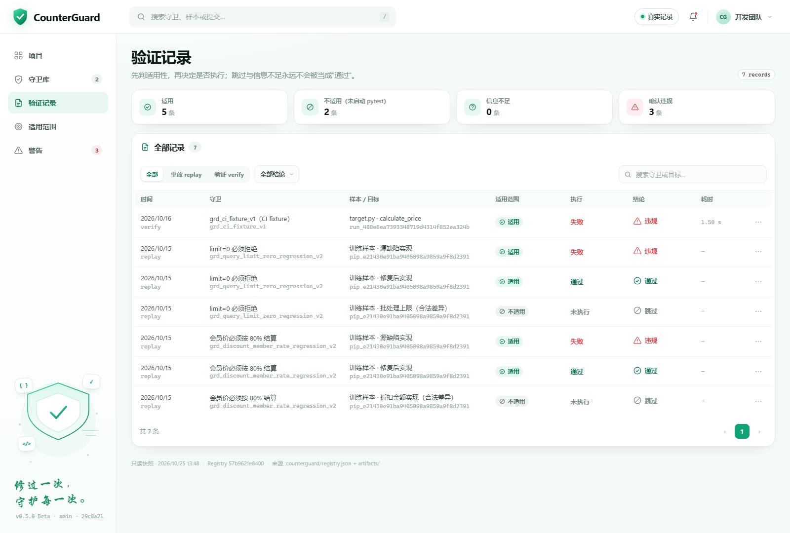
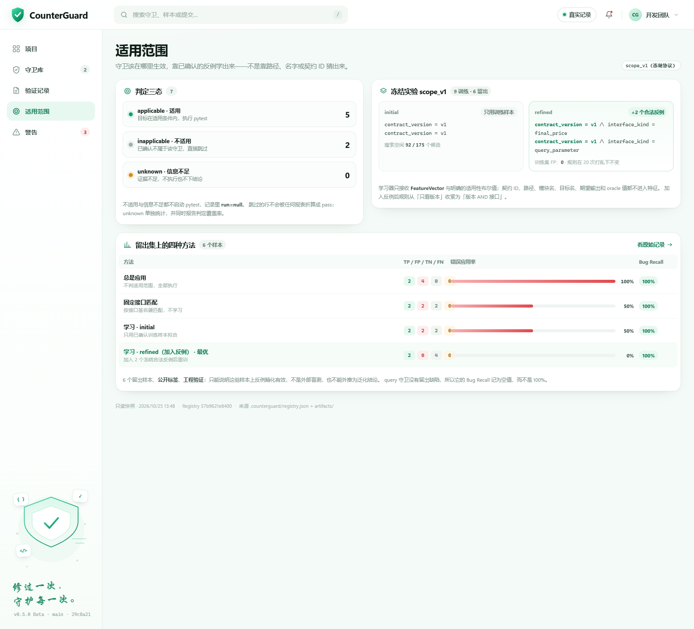

# CounterGuard 控制台

一个**不需要后端、不需要构建、离线可用**的静态控制台，用来查看 CounterGuard 的守卫、验证记录与适用范围。界面是纯静态实现，数据绑定的是项目真实产物：Registry、replay 报告、Docker verify 报告和冻结的 `scope_v1` 指标。


## 打开

直接双击 `index.html`，或：

```powershell
start index.html
```

数据通过 `assets/data.js`（`window.__CG_DATA__`）注入，因此 `file://` 下也能正常加载，不存在跨域问题。

生成的数据含本机路径，**不入库**。新 clone 后先在仓库根目录跑一次导出：

```powershell
python console/tools/export_console_data.py --root .
```

没有数据时页面只显示提示，不会伪造记录。

## 第一次使用（3 分钟）

在仓库根目录导出一次数据：

```powershell
python console/tools/export_console_data.py --root .
```

看到下面两行，说明数据已经生成（数字来自当前仓库）：

```text
Guard 2 个 · 验证记录 7 条 · 回归 3 条
适用范围实验：训练 9 / 留出 6 · 方法 4
```

然后打开 `console/index.html`，按顺序看五个地方：

1. **总览**：顶部四个数是 2 / 7 / 3 / 100%。右侧是最近一次 Docker verify 的失败断言和来源缺陷。
2. **守卫库**：点第一行 `limit=0 必须拒绝`。抽屉里是契约、接口、initial / refined 条件，以及唯一一条 case（`raw=0` 必须抛 `ValueError`）。
3. **验证记录**：先看「适用范围」这一列。`适用` 才有执行结果，`不适用` 是 `未执行`，不会被算成通过。
4. **适用范围**：对比 initial 和 refined，refined 多了 `interface_kind`；四方法表里 refined 的错误应用率是 0%。
5. **警告**：只收「确认适用 + 执行失败」的记录，当前 3 条，其中 1 条标了阻断。

## 五个页面

| 页面 | 内容 |
|---|---|
| 项目（总览） | KPI、守卫列表、最近一次验证的失败断言与来源缺陷 |
| 守卫库 | Registry 里的全部守卫，按契约 / 状态 / 最近结果筛选；点行看详情抽屉 |
| 验证记录 | 每条 replay / verify 的 `scope_decision`、`execution_outcome`、`final_verdict` |
| 适用范围 | 三态计数、initial / refined 规则、留出集四方法对比 |
| 警告 | 只收录「确认适用 + 执行失败」的违规；Shadow 阶段只记录不阻断 |





交互：搜索、下拉筛选、分页、`Esc` 关闭抽屉、`/` 聚焦搜索。深链可直接定位：

```text
index.html#/guards/grd_discount_member_rate_regression_v2
index.html#/records/vfy_001
index.html?demo=1#/overview          # 直接进入演示数据
```

## 常见操作

**查某条守卫最近怎么样。** 守卫库点行，抽屉顶部是状态和最近结果；表格的「最近结果」列同时给了时间。

**核对一次重放为什么跳过。** 验证记录点那一行，抽屉里的判定链路按 `scope_decision → execution_outcome → final_verdict` 展开。`not_run` 就是没启动 pytest。

**看某个目标为什么不适用。** 适用范围页的 refined 条件，和记录抽屉里的 clause 比对，两边能对上。

**截图或录屏。** 右上角切到「演示数据」，页面会挂横幅。录完切回真实记录，别把 128 条演示守卫当项目数据发出去。

**把某一页发给别人。** 直接用深链，比如 `index.html#/records/vfy_001`；对方用同一份导出数据就能看到同一条记录。

## 真实记录 vs 演示数据

顶栏右上角的按钮可以在两种数据之间切换（写在 `localStorage`，也可用 `?demo=1` 强制）。

- **真实记录**（默认）：全部来自本机项目，未做任何修饰。
  - `.counterguard/registry.json`、`.counterguard/entries/*.json` → 守卫
  - `artifacts/day13-smoke/report.json` → 6 条 replay
  - `artifacts/ci-demo/verify-1/verify/report.json` → 1 条 Docker verify（含失败断言与阻断标记）
  - `docs/results/scope-v1/evaluation/metrics.json` → 四方法指标
  - `artifacts/experiments/scope-v1/fitted/{initial,refined}/*.json` → 学到的适用条件
  - `benchmarks/splits/scope_v1.json` 与样本文件 → 9 训练 / 6 留出
- **演示数据**：为了展示 128 条守卫、2,431 次验证这类界面密度而**合成**的数据，每行都标在演示模式下，页面顶部有固定横幅、页脚也有标记。**它不能作为项目事实引用。**

真实记录当前只有 2 条守卫、7 条验证、3 条违规——控制台显示的就是这个量级，不会把稀疏数据美化成大样本。

## 重新导出

项目有新产物后，在仓库根目录：

```powershell
python console/tools/export_console_data.py --root .
# 或显式指定项目根
python console/tools/export_console_data.py --root <path-to-repo>
```

会同时写出：

- `assets/data.js` —— 页面实际加载的数据
- `data/console-data.json` —— 同一份 JSON，便于其他脚本消费

脚本只读项目文件，不写项目目录。缺少某个产物时会退化为空集，不会编造记录。

## 目录

```text
index.html                  页面骨架、图标精灵、侧栏插画
assets/console.css          设计令牌与全部组件样式
assets/console.js           路由、筛选、分页、抽屉、迷你图
assets/data.js              生成的数据（勿手改，不入库）
data/console-data.json      同一份数据，供程序读取（不入库）
tools/export_console_data.py  导出脚本（Python 3.10+，仅标准库）
tools/smoke_console.mjs       交互冒烟测试（可选，需 Node 18+ 与 Chrome）
shots/                      真实记录模式的界面截图
```

## 交互冒烟测试（可选）

```powershell
# 1) 用调试端口启动 Chrome（chrome.exe 在 PATH 中）
chrome --headless=new --remote-debugging-port=9333 --user-data-dir="$env:TEMP\cg-cdp" about:blank

# 2) 跑检查（在 console/ 目录下）
node tools/smoke_console.mjs
```

覆盖：列表渲染、行点击抽屉、Esc 关闭、搜索过滤、记录筛选、范围页数据、警告抽屉、真实/演示切换。当前 16/16 通过。

## 在仓库内的位置

控制台以静态文件形式随仓库分发，不进入 Python 包——`pyproject.toml` 的 wheel 只包含 `src/counterguard`，这里只有 HTML/CSS/JS 和两支独立工具。
`assets/data.js` 与 `data/` 由 `console/.gitignore` 排除，避免把本机路径和一次性快照写进历史。

如果要把它变成产品入口，建议单独开一个阶段：新增 `counterguard console --export <dir>` 复用现有字段映射；
用 `python -m http.server` 或 Typer 挂只读静态服务以避免 `file://`；再给导出器补单元测试并纳入验收记录。

## 排错

| 现象 | 原因 / 处理 |
|---|---|
| 页面显示「缺少数据文件」 | 还没导出，或导出到了别的目录。回到仓库根目录重跑导出。 |
| 数字对不上 | 数据是旧的。重新导出后按 `Ctrl+F5` 强刷。 |
| 双击没反应，或用记事本打开了 | 右键 → 打开方式 → 选 Edge 或 Chrome。 |
| 页面白屏 | 打开浏览器控制台看报错；多数是 `data.js` 没生成或被清空。 |
| 分不清当前是哪套数据 | 看顶部有没有橙色横幅、页脚有没有「当前为演示数据」。 |

## 已知边界

- 这是**只读快照**：页面不会自己刷新，也没有后端；重新导出才会更新。
- 没有登录、权限、远程 Registry；顶栏的团队/铃铛是界面元素，不承诺真实通知能力。
- 演示数据是合成的，页面已明确标注；引用数字时请使用真实记录模式。
- 摘要只用于一致性检查，不作为签名或身份认证——和项目本身的表述保持一致。
