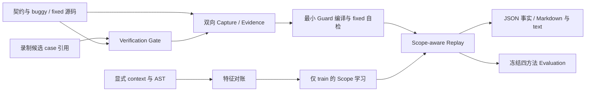

# MVP 架构与信任边界

MVP 0.1.0 只对可信本地 Python/pytest 代码执行。目标是把一次已复现缺陷沉淀为可追溯的最小 Guard，再用已确认合法反例约束其适用范围。

Pipeline 编排两组 Capture → Compile → initial/refined fit → 六行 Replay，Demo 再从已验证来源生成统一报告。Evaluation 是消费已冻结 fits 的独立留出评测入口；标准 Demo 不重新运行 holdout。

| 边界 | 模块 | 必须保持的保证 |
|---|---|---|
| 候选 → 可信证据 | model_client.py、independent_verifier.py、verification_gate.py | 候选只引用完整契约中的 case；可信模板生成测试。Agent 没有 oracle 或 Evidence 发布权 |
| 执行 → Evidence | execution.py、evidence.py、models.py | buggy 真实失败且 fixed 通过才 reproduced；原始日志、case 映射、退出语义与来源身份一致 |
| Evidence → Guard | compiler.py | 精确保留这次实际失败且已修复的 case，不复制全部契约；fixed 自检需通过 |
| 源码/context → learner | features.py、module_context.py、scope.py、predicates.py | FeatureRecord 保存外层来源；纯 learner 只收 FeatureVector 和显式标签，holdout 不进 fit |
| Scope → Replay | replay.py | applicable 才执行；unknown/inapplicable 的 run=null；stale 和基础设施错误单独记录 |
| 来源 → 结果 | protocol.py、evaluation.py、evaluation_metrics.py、pipeline.py、demo.py、report.py | 冻结协议与计数；原始事实重建；源码/环境 pin；展示不把 skipped 当 pass |
| 发布与路径 | artifacts.py、workspace.py、path_limits.py | 相同身份不同字节拒绝覆盖；输入镜像白名单；含原子临时文件的路径预算 |

每个独立 verify 都必须核对自己的来源边界，外层 Pipeline 的检查不能代替独立审核。摘要链用于一致性检查，不认证操作者、主机或 OS 执行真实性。原始日志继续是私有证据；诊断摘要脱敏不代表完整报告可以公开。

格式和重算依赖见 [数据契约](data-contracts.md)，指标和历史留出结果见 [评测说明](evaluation.md)。[攻击面清单](attack-surface-checklist.md) 列出已测、部分与未实现边界；W3 的 Docker/仓库接入和 Registry 仍是待开发能力。
