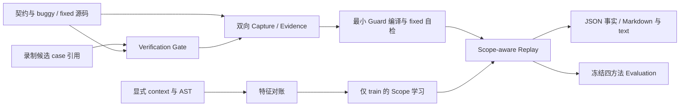

# 架构与信任边界

CounterGuard 只执行审核过的代码：本地可信的 Python / pytest 代码，或在审核过的 Docker 镜像里运行的固定仓库快照。它把一次已复现的缺陷编译成最小 Guard，再用已确认的合法反例约束这个 Guard 的适用范围。

一次标准 Demo 的顺序是：两组 Capture、Compile、initial / refined 拟合、六行 Replay，最后由已验证来源生成报告。Evaluation 是独立入口，只消费冻结的拟合结果去跑留出集；Demo 不会重跑 holdout。

| 环节 | 模块 | 必须守住的保证 |
|---|---|---|
| 候选 → 可信证据 | `model_client.py`、`independent_verifier.py`、`verification_gate.py` | 候选只能引用完整契约里的 case，测试由可信模板生成。Agent 没有 oracle，也不能发布 Evidence |
| 执行 → Evidence | `execution.py`、`evidence.py`、`models.py` | 旧版真实失败、新版真实通过才算 reproduced；原始日志、case 映射、退出语义和来源身份要一致 |
| Evidence → Guard | `compiler.py` | 只保留这次实际失败且已修复的 case，不复制整套契约；fixed 自检必须通过 |
| 源码 / context → learner | `features.py`、`module_context.py`、`scope.py`、`predicates.py` | FeatureRecord 保留外层来源；learner 只接收 FeatureVector 和显式标签，holdout 不进入拟合 |
| Scope → Replay | `replay.py` | 只有 applicable 才执行；unknown 和 inapplicable 的 run 为 null；stale 与基础设施错误单独记录 |
| 来源 → 结果 | `protocol.py`、`evaluation.py`、`evaluation_metrics.py`、`pipeline.py`、`demo.py`、`report.py` | 冻结协议与计数；从原始事实重建；固定源码与环境；展示时不把 skipped 当 pass |
| 发布与路径 | `artifacts.py`、`workspace.py`、`path_limits.py` | 相同身份不同字节拒绝覆盖；输入镜像走白名单；路径预算包含原子临时文件 |

每个独立 verify 都要核对自己的来源边界，外层 Pipeline 的检查不能替代它。摘要链只用于一致性检查，不认证操作者、主机或 OS 执行真实性。原始日志是私有证据，诊断摘要脱敏也不代表整份报告可以公开。

格式与重算规则见[数据契约](data-contracts.md)，指标与历史留出结果见[评测说明](evaluation.md)，已测、部分覆盖和未覆盖的边界见[攻击面清单](attack-surface-checklist.md)。
